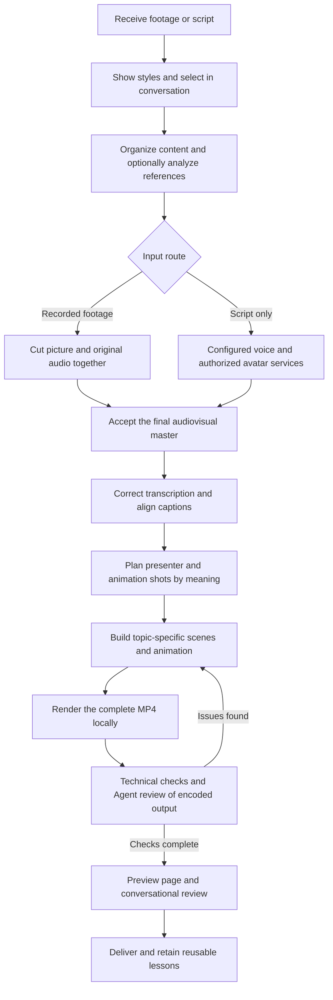

# Talking Head Motion · 网感口播剪辑 Skill

[简体中文](README.md) | [English](README.en.md)

An Agent Skill for understanding narration, arranging presenter footage and animation, and exporting a complete MP4 locally. It supports editing recorded talking-head footage with its original audio, or producing a video from a script with configured voice and avatar services. Styles are shown on a preview page; selections and revisions happen in the conversation.

The Agent handles meaning, assets, storyboarding and review. Local scripts handle deterministic rendering, caching and technical checks.

## Features

- **Edit original footage**: keep the original picture and voice together when cutting mistakes, repeated sentences and retakes. Preserve pauses that serve the delivery.
- **Bring the presenter back throughout the video**: show the presenter for the opening, key claims, emotional turns, conclusions and closing. Explanatory shots can retain a picture-in-picture window.
- **35 art styles**: code for materials, brushwork, shapes, palettes, lighting and motifs. Objects and scenes are redesigned for each new topic.
- **8 parameterized animation grammars**: whiteboard, collage, kinetic typography, charts, geometry, product interfaces, flat illustration and storytelling. A ninth presenter-explainer method card requires project-owned presenter assets.
- **Reference analysis and effect reconstruction**: study motion paths, masks, layers, holds, transitions and their narrative purpose, then build components with replaceable content.
- **Word-timed animation**: anchor actions and captions to real timestamps from the final master, rather than evenly dividing time or inserting cards at fixed intervals.
- **Conversational review**: the preview page offers playback, shot navigation, synchronized comparisons and downloads. Style selection, feedback and approval happen in the conversation.
- **Local delivery**: MP4, SRT, project files, asset sources and review records tied to the actual output version.

## Complete workflow



Reuse the style already selected for the current project; new instructions override previous choices. If a style has not been selected for a finished single-style video, show existing previews and ask the user to choose in the conversation. Continue organizing footage, the script and assets while waiting. If the user explicitly delegates the choice, the Agent may select a suitable style and explain it. Produce multiple complete comparison videos only when requested.

Detailed references: [production workflow](references/production-workflow.md), [original footage editing](references/raw-talking-head.md), [presenter-led editing](references/editorial-playbook.md) and [full Huashu production](references/huashu-full-production.md). The detailed skill references are currently in Chinese.

## Install in Codex

You need Git, Python, Node.js, FFmpeg/ffprobe and Chromium. The basic Python entry points use the standard library; transcription, visual checks and scene rendering require additional dependencies as needed.

```bash
git clone https://github.com/maomyu/talking-head-motion.git "$HOME/.codex/skills/talking-head-motion"
```

If the destination already exists, preserve any local changes before updating it or choosing another directory. Reload your Skill-compatible client, then invoke `talking-head-motion`. Other compatible clients can use their own skill directory; browser tools and review capabilities depend on the client.

Set up local dependencies:

```bash
cd "$HOME/.codex/skills/talking-head-motion"
python3 -m venv .venv
source .venv/bin/activate
python3 -m pip install -r requirements.txt
python3 -m pip install numpy
python3 -m playwright install chromium
cd assets/runtime
npm ci --ignore-scripts --no-audit --no-fund
cd ../..
python3 scripts/motion.py doctor
```

Node dependencies are pinned in `assets/runtime/package-lock.json`; no global HyperFrames installation is required. Install FFmpeg/ffprobe separately. You may reuse an existing working environment. The first transcription model download requires network access.

## Usage

Give the Agent the path to your original footage and the desired art style. For example:

> Use talking-head-motion to edit my recorded talking-head video at `/absolute/path/raw.mp4`. Use the ink-painting style, preserve my original voice, bring the presenter back throughout the video, and export a complete portrait video. Handle all revision feedback in this conversation.

You can also provide a script and references. A script-only route requires configured voice and avatar master providers. Editing original footage does not require Fish, MiniMax or Gemini accounts.

Run `produce.py` after preparing the accepted master, final word timestamps and semantic storyboard:

```bash
python3 scripts/produce.py /absolute/project --model small --expected-script script.txt
```

It runs transcription when needed, cached B-roll production, composition building, browser checks, rendering and full decoding. A successful command still requires Agent review; it does not replace understanding the script, choosing evidence or judging the visuals. See the [project contract](references/project-contract.md) for commands and file conventions.

List the available art-style capabilities:

```bash
python3 scripts/huashu_full.py catalog
```

The local review server binds only to `127.0.0.1`. The page has no feedback forms, ratings, or controls for saving or exporting review notes. Videos, assets and review records stay in their production projects and are not distributed with this repository.

## Validation and limitations

- Local production completed 35 same-content style comparisons, each approximately 75 seconds at 1080×1920 and 24fps, with full decoding and sampled encoded-frame reviews. Those project videos use clearly labeled stock-presenter footage and are not distributed here. This validation does not establish personal-avatar lip-sync quality or successful editing of a user's first real recording.
- Technical, visual, caption, audio and reference-fidelity checks are reported separately. Inspecting frames or reading transcripts is not a complete real-time audiovisual review. Unchecked areas must be disclosed.
- The 35 styles are material and drawing mechanisms that require topic-specific staging. Replacing the script alone is not guaranteed to produce a new finished video. The 8 grammars and 35 styles are not 280 verified automatic combinations.
- Reference effects require observation and reconstruction. This repository does not provide a general inverse-effects algorithm for arbitrary videos or guarantee viral performance.
- Avatar providers, authorized likenesses, voices, costs and service capabilities must be checked in the actual project. Remote Gemini review is optional; the current Codex Agent is the default reviewer.
- The original 35 room scenes are 1920×1080 capability examples. New portrait videos require redesigned compositions. The author's private characters, audio, showcase media and service configuration are excluded.

See the [review rules](references/quality-review.md), [full-film style comparisons](references/style-batch.md) and [per-style implementation limits](assets/style-batch/catalog.json).

## Sources and licenses

This project's original workflow, adaptation code and documentation use the [MIT license](LICENSE). Huashu's engine, art recipes and methods come from [alchaincyf/huashu-art-motion](https://github.com/alchaincyf/huashu-art-motion). The original author's copyright and MIT license are retained, with the source pinned to commit `9ff59339f934e08483ba0a5b1db20f4c2c421b35`.

Fonts retain their respective SIL OFL 1.1 terms. The Hanzi stroke subset uses the Arphic Public License. These assets are not relicensed by the root MIT license. Installed runtime dependencies also retain their own licenses. See [third-party notices](THIRD_PARTY_NOTICES.md) for scope, attribution and exclusions.

Research into Hypit, Talkcraft and other sources informed the workflow; their code and media are not bundled as this project's runtime. This project is not an official product of those authors or services.
