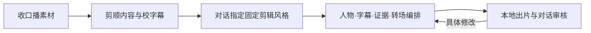

# Talking Head Motion · 30款网感口播剪辑风格

[简体中文](README.md) | [English](README.en.md)

**选一种口播剪辑风格，把你的自拍原片剪成完整视频。**

这是一套以固定口播风格库为核心的 Agent Skill：保留真实人物与原声，按句意安排重点字幕、人物窗口、证据画面和转场，在本地导出 MP4。风格在网页展示，选择与修改都在对话里完成。

## 核心：可以直接指定的口播风格

30个来源形成稳定入口 **TH-DY-01～TH-DY-30**，每款有名称和版本。同款包含多种编排时列为子版本；共享动画机制明确关联，不把30个来源宣传成30套互不重复的原创语法。

风格配方约束配色、文字体系、版式、人物占比、进入/退出和转场；文案、人物与证据素材可以替换，动作按新口播的真实词轴重新编排。典型编排包括青绿字块与漫画强调、弧字圆窗、虚线人物与资料卡、薄荷三联卡、人物遮挡大字、六格接力、图表证据和裂屏转折。

[风格目录](assets/fixed-styles/catalog.json) · [选择与套用](references/fixed-talking-head-styles.md) · [逐帧重建规范](references/native-frame-reconstruction.md)。各款实际重建、替换和审片范围以目录和验证记录为准，未完成的部分明确标记。原片与项目预览留在本机，不随代码仓库分发。

当前配方版本为 **0.1.0**：30个基础风格入口已固定，精细原生窗口及同源子版本按实际完成范围逐条更新。基础机制演示与逐帧精细验收分别记录。

## 五步制作



1. **收素材**：接收自拍原片或已生成的数字人母片，检查真实取景、声音和内容。
2. **剪内容**：原画原声同步处理口误、重复和重录段，保留自然停顿；对最终母片校正字幕。
3. **定风格**：沿用已确认的选款，或在对话指定名称/编号；冻结配方与版本。
4. **编排**：按句意用所选风格组织画面，人物承担主线，关键观点和结尾多次回到人物。
5. **出片审核**：导出完整MP4、SRT和工程，检查实际编码画面与同步；修改意见在对话里提出。

已有配方直接复用，不必每条重新拆参考、制作全库对照或先做艺术场景。风格可以收片时就指定，流程不是让用户依次填表。[完整执行与续跑](references/production-workflow.md) · [自拍原片](references/raw-talking-head.md) · [编排规则](references/editorial-playbook.md)。

## 怎么使用

> 用 talking-head-motion 剪 `/absolute/path/raw.mp4`，风格用 TH-DY-13。保留我的原声，重点观点多次回到人物画面，输出9:16完整MP4。

用户已指定风格直接沿用；尚未指定正式单版时，Agent展示现有视频并在对话提醒，等待期间继续整理原片和字幕。网页只有播放、切换、逐帧对照和下载，没有选择表单、意见填写或评分入口。

内部配方锁定由Agent执行：

```bash
python3 scripts/fixed_styles.py list
python3 scripts/fixed_styles.py bind /absolute/project --style TH-DY-13 --choice-source '用户在对话指定TH-DY-13'
```

母片、最终词轴和镜头表就绪后，本地制作命令为：

```bash
python3 scripts/produce.py /absolute/project --model small --expected-script script.txt
```

脚本负责缓存、编译、渲染和技术检查，当前Agent继续审实际成片。脚本不会自动理解所有语义，也不会把机械通过当作视觉验收。[项目命令与数据](references/project-contract.md)。

## 按需要增加的能力

- **形成口播母片**：已有自拍直接剪；照片＋音频按已配置的HeyGen衔接，不重复配音；只有文案时才补配音与授权形象。公开包包含Fish配音适配器，HeyGen提交适配器和账户仍需配置、实测，再进入同一主线。[服务衔接](references/provider-handoff.md)。
- **学习新风格**：完整下载参考、遍历原生RGB/PTS，密集测量关键动作，重建独立图层并检查最终编码。通过后增加版本配方；日常套用不重复这项研究。[原生重建](references/native-frame-reconstruction.md)。
- **艺术插镜**：需要特殊科普、概念或艺术画面时，可选35艺术画风与8通用语法。它们是插镜能力，与30个固定口播风格入口分开管理，不是每条口播都要经历的选择步骤。[可选艺术能力](references/huashu-integration.md)。

默认由当前Codex审片，无需另配Gemini。声音、数字人和艺术渲染都不是自拍剪辑的必经步骤。

## 安装

需要Git、Python、Node.js、FFmpeg/ffprobe和Chromium。已有目录先保留修改再更新；不要覆盖现有工程或服务配置。

```bash
git clone https://github.com/maomyu/talking-head-motion.git "$HOME/.codex/skills/talking-head-motion"
cd "$HOME/.codex/skills/talking-head-motion"
python3 -m venv .venv
source .venv/bin/activate
python3 -m pip install -r requirements.txt
python3 -m playwright install chromium
cd assets/runtime
npm ci --ignore-scripts --no-audit --no-fund
cd ../..
python3 scripts/motion.py doctor
```

已有可用依赖直接复用，不重复下载。Node版本固定，不需要全局安装HyperFrames；FFmpeg/ffprobe另行安装。完整原生账本需要C编译器，首次ASR模型下载需要网络。其他兼容客户端可以使用各自Skill目录，实际审片能力由客户端提供。

## 验证程度

- 风格库把固定身份、实际编码窗口、原生时间轴、颜色/几何测量和残差分别记录；具体范围见 [原生验证](assets/reference-engine/validation.json) 和 [早期机制验证](assets/social-grammars/validation.json)。早期4秒机制演示不能冒充精细原生重建。
- 已完整解码30条参考共89,080帧；机器遍历不等于Agent已理解全部画面，也不等于每款任意替换内容都通过。配方未识别的原字体、被遮挡素材和作者原工程需要具体说明。
- 使用真实图库人物的无口型研究片，只验证对应动画与取景；本人正式口播、数字人口型和首次自拍实践要另外检查。
- 同步、字幕、视觉、证据与技术检查分别报告。放大不增加原片细节；抽帧和读转写不等于全程实时试听。新文案、新人物与新取景需要相应检查。
- 不提供任意视频自动逆向算法，不保证爆款。保留必要的真实成片审查，不把复杂内部步骤转成用户审批表。

## 来源与许可证

本项目维护的口播流程、适配实现与文档使用 [MIT](LICENSE)。30款固定口播风格建立在实际参考学习和本项目重建上，来源链接、共享机制与验证范围保留；原参考媒体属于原作者，留在私有制作工程。

可选艺术引擎与配方来自 [alchaincyf/huashu-art-motion](https://github.com/alchaincyf/huashu-art-motion)，保留原版权、MIT许可证和来源commit `9ff59339f934e08483ba0a5b1db20f4c2c421b35`。字体遵循各自SIL OFL 1.1，笔顺子集使用Arphic Public License；分割模型、原视频、提取字形、API凭证和生成项目不随本包开源。详见 [第三方声明](THIRD_PARTY_NOTICES.md)。

Hypit、Talkcraft等研究用于理解方法，没有打包它们的代码或媒体；本项目不代表上述作者或服务的官方产品。
