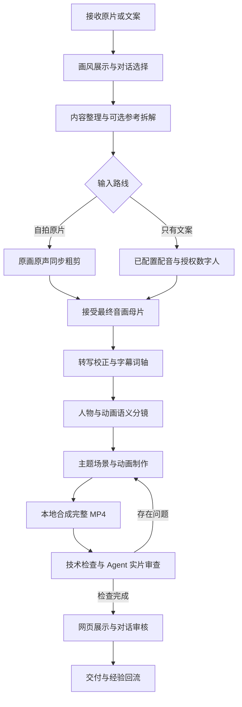

# Talking Head Motion · 网感口播剪辑 Skill

[简体中文](README.md) | [English](README.en.md)

让 Agent 理解口播、编排人物与动画，在本地导出完整 MP4。支持自拍原片保留原声剪辑，以及已配置配音／数字人服务的文案路线。画风在网页展示，选择与修改在对话完成。

这是一个 Agent Skill 和本地制作工具集。Agent 负责文意、素材、分镜和审片；脚本负责确定性渲染、缓存与技术检查。

## 能做什么

- **真人原片剪辑**：保留原始画面与原声，同步裁切口误、重复句和重录段，保留有表达意义的停顿。
- **人物反复出镜**：开场、关键观点、情绪转折、结论和结尾回到人物；解释画面可以保留人物小窗。
- **35种艺术画风**：提供材质、笔触、形状、色板、光影和母题代码，按新主题重写物体与场景。
- **8种参数化动画语法**：白板、拼贴、动效文字、图表、几何、产品界面、扁平科普、故事表达；另有第9张讲解员方法卡，需要项目自有人物素材。
- **28个口播动画与版式模块**：从抖音实际搜索前30条的选定窗口重建字块、人物缩窗、弧字、抠像层级、碎字、图表、蒙版和素材拼格，重复机制合并；支持换文案/素材与真实人物视频逐帧取帧。[来源与用法](references/douyin-grammars.md)、[实测范围](assets/social-grammars/validation.json)。
- **参考拆解与效果重建**：观察运动路径、遮罩、层次、停留、转场和语义作用，制作可替换内容的组件。
- **原生逐帧精细重建**：完整原片逐帧 RGB／PTS 账本、原生帧轨迹、动态真人 RGBA、固定字形私有研究层和实际编码对照。按源窗口时长渲染，网页支持前后逐帧；这是测量驱动的工具，不是任意视频自动逆向算法。[执行规范](references/native-frame-reconstruction.md)、[实际验证范围](assets/reference-engine/validation.json)。
- **词轴驱动**：按最终母片的真实时间戳安排动作和字幕，不均分时间或机械定时插卡片。
- **对话驱动审核**：网页提供播放、镜头跳转、同时间对照和下载；选择、意见和确认在对话中处理。
- **本地交付**：MP4、SRT、工程、素材来源和绑定实际输出版本的审片记录。

## 完整流程



已在当前项目指定的画风直接沿用，新指令覆盖旧选择。未指定正式单版画风时，先展示已有预览，再在对话提醒选择；等待期间继续整理原片、文案和素材。用户明确让 Agent 自选时，可按内容选择并说明。仅在用户要求时制作多款完整对照片。

详细流程：[生产流程](references/production-workflow.md)、[自拍原片](references/raw-talking-head.md)、[人物编排](references/editorial-playbook.md)、[花叔完整制作](references/huashu-full-production.md)。

## 安装到 Codex

需要 Git、Python、Node.js、FFmpeg/ffprobe 和 Chromium。Python 基础入口使用标准库；转写、画面检查和场景渲染按需安装额外依赖。

```bash
git clone https://github.com/maomyu/talking-head-motion.git "$HOME/.codex/skills/talking-head-motion"
```

若目标目录已经存在，先保留已有修改，再选择更新或使用另一目录，不覆盖现有技能。重新加载支持 Skill 的客户端后，调用 `talking-head-motion`。其他兼容客户端可将仓库放入其技能目录；浏览器工具与审片能力取决于客户端。

准备本地依赖：

```bash
cd "$HOME/.codex/skills/talking-head-motion"
python3 -m venv .venv
source .venv/bin/activate
python3 -m pip install -r requirements.txt
python3 -m playwright install chromium
cd assets/runtime
npm ci --ignore-scripts --no-audit --no-fund
cd ../..
python3 scripts/motion.py doctor
```

Node 依赖版本固定在 `assets/runtime/package-lock.json`；不需要全局安装 HyperFrames。FFmpeg/ffprobe 须自行安装；全帧账本的精确 RGB 内核另需本机 C 编译器。已有可用环境时可以复用；第一次转写模型下载需要网络。

## 怎么使用

在 Agent 对话中提供原视频的路径，并说明选用的画风，例如：

> 用 talking-head-motion 帮我剪这条自拍口播：`/absolute/path/raw.mp4`。用水墨画风，保留原声，人物多次回到主画面，输出竖屏完整视频。修改意见都在对话里说。

也可以提供文案和参考，但只有文案时，需要已配置的配音与数字人母片提供方。真人原片路线无需 Fish、MiniMax 或 Gemini 账号。

`produce.py` 的入口在母片、最终词轴和语义分镜准备好之后运行：

```bash
python3 scripts/produce.py /absolute/project --model small --expected-script script.txt
```

它执行转写（需要时）、缓存的 B-roll、编译、浏览器检查、渲染及完整解码。成功后仍需 Agent 审片；命令本身不替代文案理解、证据选择或视觉判断。完整命令与文件约定见 [项目契约](references/project-contract.md)。

查看画风能力清单：

```bash
python3 scripts/huashu_full.py catalog
```

本机审核页只绑定 `127.0.0.1`。网页不设意见输入、打分、保存或导出意见入口。视频、素材与审核记录留在各自项目中，不随此仓库发布。

## 验证程度与边界

- 本地制作中已完成35条同内容、约75秒的1080×1920、24fps画风对照，并做完整解码及编码帧采样审查。这些带图库人物示意的项目视频未随仓库分发；该验证不等于本人数字人口型或首次自拍剪辑实战通过。
- 验证分技术、视觉、字幕、音频和参考对应程度分别报告。抽帧／读取转写不等于完整实时试听，未实际检查的范围要注明。
- 35种画风是材料与绘画机制，需按题材编排；不保证只换文案即可完成新片。8种语法与35种画风不是已经验证的280种自动组合。
- 参考效果需要观察与重建，未提供任意视频动画的通用逆向算法，也不承诺视频会成为爆款。
- 旧口播模块的本机验证为30组4秒机制片与30组复用片，含静态版式；不是30条完整新人口播，也未还原教程内每种效果。新的原生重建路线另外支持移动 RGB／RGBA 序列，不能把该能力当作旧28模块都已升级并通过精细验收。
- 新路线已完整解码30条原片共89,080帧；精细重建与编码逐帧审查目前覆盖两个选定窗口（141帧与60帧），仍有字形、遮挡、颜色与轨迹残差，其余28条及两条的其余时段尚未完成精细重建。详见[原生路线验证记录](assets/reference-engine/validation.json)。
- 动态真人试验使用真实图库拍摄视频，303帧 alpha 对齐原生25fps，原 RGB 逐字节核验通过；头发、脸部与衣服有实际审查，耳机附件仍存在半透明误分。分割模型未随本包分发，研究片段不证明本人数字人或口型同步。
- 数字人提供方、授权形象、音色、费用与服务能力在实际项目中核对。远程 Gemini 质检仅为可选补充，默认由当前 Codex 审查。
- 原35个房间场景是1920×1080能力例子；新竖屏口播需重新构图。作者私人角色、音频、示范片与服务配置未纳入。

详见 [质检规则](references/quality-review.md)、[完整画风对照](references/style-batch.md) 和每个画风的 [实现限制](assets/style-batch/catalog.json)。

## 来源与许可证

本项目的原创流程、适配代码与文档采用 [MIT](LICENSE)。花叔引擎、画风配方及方法来自 [alchaincyf/huashu-art-motion](https://github.com/alchaincyf/huashu-art-motion)，保留原作者版权和MIT许可证，固定来源 commit 为 `9ff59339f934e08483ba0a5b1db20f4c2c421b35`。

字体使用各自的 SIL OFL 1.1；汉字笔顺子集使用 Arphic Public License。它们不由根目录MIT重新授权。安装的运行时依赖也遵循各自许可证。完整范围、署名及排除项见 [第三方声明](THIRD_PARTY_NOTICES.md)。

Hypit、Talkcraft 等研究来源用于理解工作方法，没有把它们的代码或媒体打包为本项目运行时。本项目不代表上述作者或服务的官方产品。
